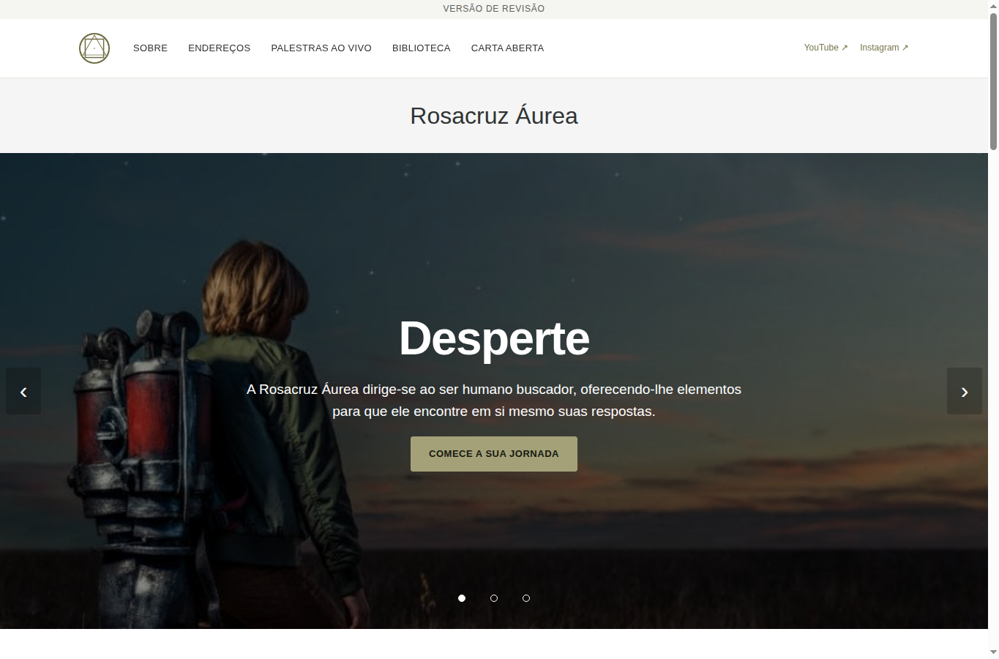
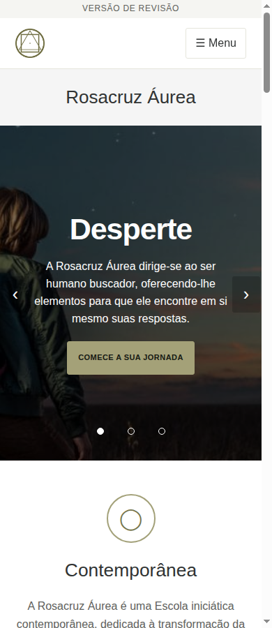
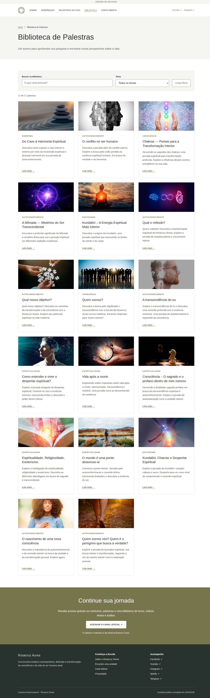
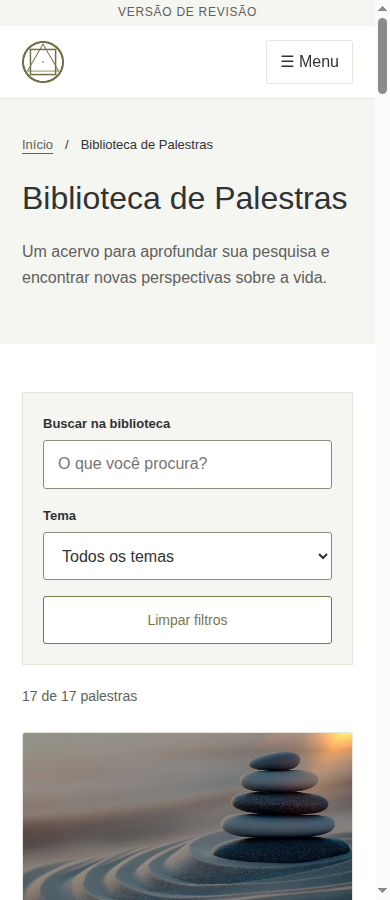
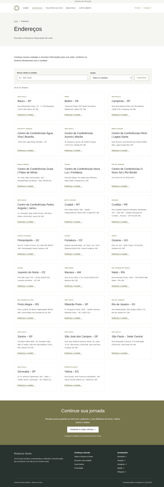

## Atualização de preparação, 19/10/2026

Autenticação disponível; repositório remoto vazio, sem main existente. Esta branch inclui um commit inicial vazio para servir de base caso a criação da main seja autorizada. O preview foi autorizado por André. Nenhum merge é autorizado. O corpo definitivo do PR deve refletir os resultados remotos, não os bloqueios históricos abaixo.

# Versão pública em HTML, CSS e JavaScript puros

Descrição preparada localmente para o PR. **O PR ainda não foi aberto no GitHub.** Branch local: `feat/vanilla-site`; destino solicitado: `rosacruzaurea/static-site`. A branch-base e as automações precisam ser confirmadas após disponibilizar autenticação. Não fazer commit direto na principal, merge ou deploy.

## Resumo

- 72 páginas estáticas com conteúdo separado dos templates; sem framework ou WordPress na execução.
- Biblioteca com 17 palestras, busca e filtro de tema; diretório com 26 unidades e filtro por estado.
- Interface responsiva, menu móvel e carrossel manual; conteúdo e navegação essenciais disponíveis sem JavaScript.
- Imagens locais. Cadastros, vídeos e mapas acessados por links aos canais oficiais, sem carregamento automático de terceiros.

## Prints das principais telas

Capturas reais da versão local em Chrome, não do site de produção. O código da aplicação permanece no candidato `1060e90b71f530c3486186b74a7511153bd0a445`; esta complementação acrescenta apenas documentação e cópias das capturas existentes. Capturas de 19/10/2026, viewport de 1365 × 900 ou 390 × 900; as duas capturas completas abaixo têm altura maior que a janela.

### Início no computador

### Início no celular

### Biblioteca no computador, página completa

### Biblioteca no celular

### Endereços no computador, página completa

## Verificação já executada

- 72 páginas e 1.525 referências internas verificadas, sem falhas.
- 72 respostas HTTP 200 no preview local.
- 103 verificações de layout/interação aprovadas em Chrome, com larguras de 1365, 390 e 320 pixels.
- Menu, carrossel, busca/filtros, estados vazios e navegação sem JavaScript contemplados.

Evidências e limites em [VERIFICACAO.md](VERIFICACAO.md). A checagem estática foi repetida durante a preparação de um artefato para GitHub Pages; as 1.525 referências também foram verificadas sob o caminho de projeto `/static-site/`. Os testes de navegador anteriores não foram repetidos, pois o código não mudou. Links locais dos prints e integridade das cópias foram conferidos. Autorrevisão não equivale a homologação independente.

## Limites da entrega

- Não é migração integral do backend, de cadastros ou de áreas restritas.
- Conteúdo, programação, contatos e direitos ainda precisam de validação editorial antes de publicação.
- Sem merge, deploy, mudança de domínio ou alteração da principal. Versão mantém aviso de revisão e bloqueio de indexação.
- Safari, Firefox, aparelhos físicos, acessibilidade integral e integrações externas não foram homologados.

## Procedimento para abrir o PR

1. Com autenticação disponível, ler instruções, histórico e automações reais do destino; preservar arquivos existentes.
2. Integrar esta preparação em branch separada baseada no histórico remoto; não usar force push.
3. Confirmar o envio e o SHA remoto. Abrir PR em rascunho para a branch-base confirmada, sem merge automático.
4. Publicar o resumo e as capturas acima no corpo do PR, convertendo os caminhos relativos das imagens em URLs do commit remoto confirmado. Verificar a renderização dos prints no PR e compartilhar seu link no grupo.

O pedido de Dani na mensagem 3461 especifica PR e prints antes de qualquer mudança na main; a autorização de implementação/envio concedida por André continua válida. Não há autorização de merge ou publicação.

Pedido seguinte de Dani: priorizar uma URL navegável no GitHub Pages. O artefato foi preparado localmente, sem alterar este código; a configuração do destino e a publicação aguardam credencial utilizável e autorização específica de André. Um Pages já existente não será substituído por inferência. Acrescentar ao PR a URL real somente após publicação autorizada e verificação.

### Autorização posterior confirmada

André, mensagem 3483 de 19/10/2026, autorizou publicar e delegou à Dani autoridade neste projeto. Assim, as menções acima à falta de autorização de publicação registram o estado anterior e estão superadas. A abertura do PR e a publicação de revisão aguardam somente acesso técnico utilizável e inspeção do destino. Não houve pedido de merge na main, nem autorização para substituir por inferência um Pages preexistente. Nenhum PR ou deploy foi criado até este registro.
